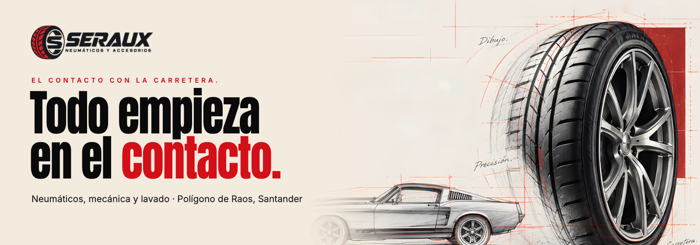
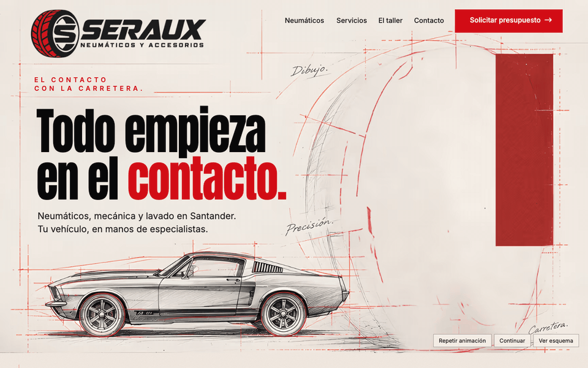
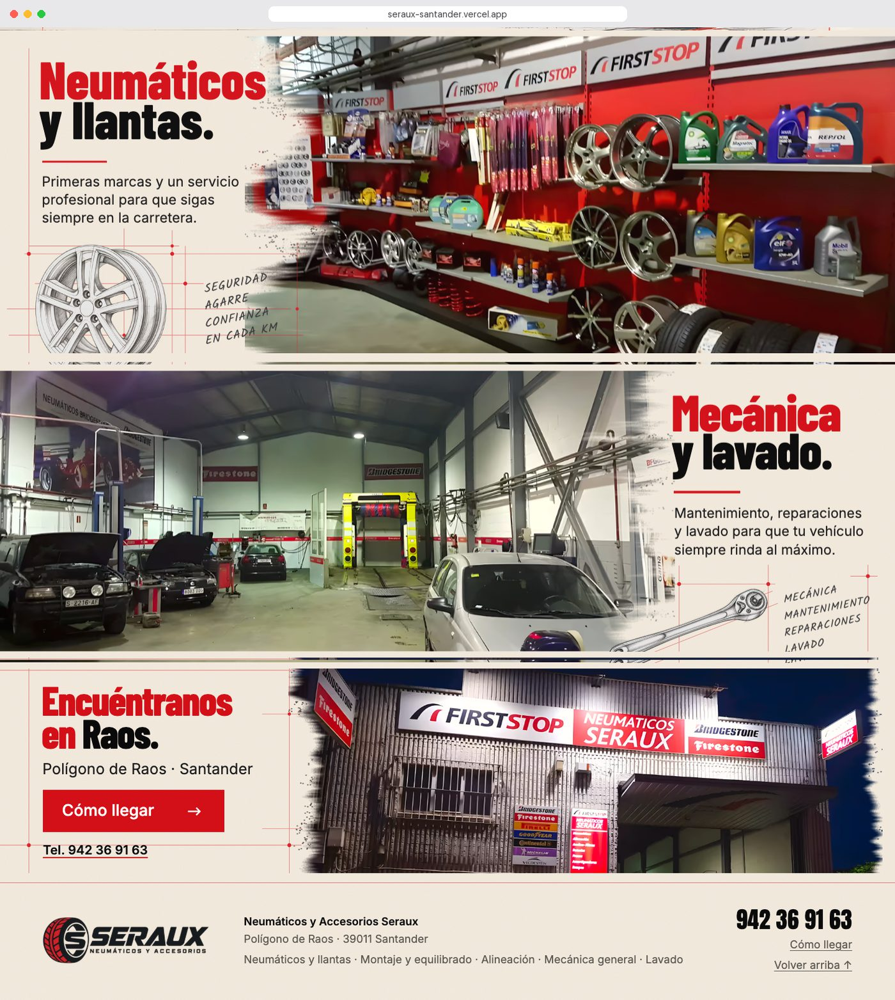
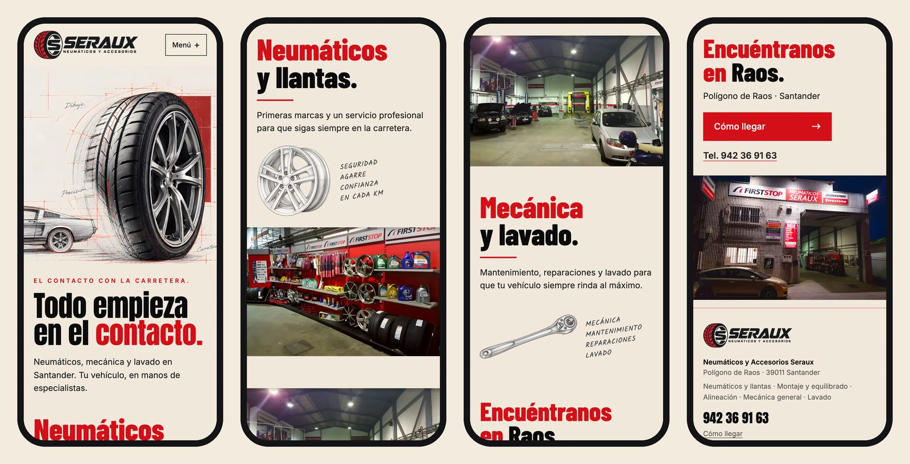

<div align="center">



<h3>A one-page website for a tyre, mechanics and car-wash workshop in Santander, opened by a tyre that goes from pencil sketch to rubber and metal.</h3>

<p>
  <a href="https://seraux-santander.vercel.app"><strong>🌐 Live site</strong></a>
  &nbsp;·&nbsp;
  <a href="#hero-animation"><strong>🎬 How the hero works</strong></a>
  &nbsp;·&nbsp;
  <a href="#getting-started"><strong>🛠️ Run it locally</strong></a>
</p>

<p>
  <a href="https://seraux-santander.vercel.app"></a>
  
  
  
  
</p>

</div>

<br />

## 🚀 Overview

**SERAUX** (Neumáticos y Accesorios Seraux) fits tyres and wheels, services cars and runs a car wash in the Polígono de Raos, Santander. The site is built on one line from the brief, *Todo empieza en el contacto.*: everything starts where the tyre meets the road. The page opens on a technical drawing on drafting paper, and the tyre on it is drawn in graphite before a red scan line turns it into real rubber and metal.

Below the hero, three light "drafting sheets" pair the copy with the workshop's own photos: the tyre and wheel display, the workshop floor with its wash tunnel, and the façade in Raos with a **Cómo llegar** button and the phone number.

- **Built from the approved design**: on desktop the page reproduces the approved board, with every word set as live HTML text
- **Real place, real photos**: the three photos are the shop itself, cleaned of the photo viewer they were captured from
- **Straight to the phone**: every quote button calls the workshop; there is no fake form
- **Light**: under 1 MB for the whole page on desktop and phone, fonts included, and the animation layers only load when the intro plays

<br />

<a name="hero-animation"></a>

## 🎬 The hero animation

<div align="center">
  <a href="https://seraux-santander.vercel.app"></a>
  <sub>Plays once on load on the live site · captured at 1440 × 900</sub>
</div>

<br />

A finite 4.8 s intro that follows the kit's motion script (`06-roteiros/ANIMACAO.md`). The text is visible and clickable from the first frame and the page never locks scrolling.

| Time      | What happens                                                                                         |
| :-------- | :--------------------------------------------------------------------------------------------------- |
| 0–1.4 s   | Drafting paper, the car sketch and the red plane; the tyre's outline, rim and hub draw in graphite   |
| 0.3–1.4 s | A pencil study of the same tyre fades in underneath the lines                                        |
| 1.4–3.6 s | A red vertical scan sweeps left to right; behind it, rubber and metal replace the drawing             |
| 3.6–4.8 s | The lines lose presence, the scan fades out and the approved still remains                           |

**Under the hood**

- 🖼️ **One plate, three states.** The approved hero is the plate. A *paper* state (tyre removed, red plane completed, construction lines kept) and a *pencil* state (a colour-dodge drawing of the same tyre) were derived from it, so every layer is registered by construction and the last frame is the approved image itself.
- ✂️ **A clip, not a distortion.** The reveal is a `clip-path` wipe synced to the scan line; the tyre keeps its perspective and nothing rotates.
- 🎛️ **Controls in Spanish.** *Repetir animación*, *Pausar / Continuar* and *Ver esquema*, which fades the photo over the line study for a static look. Built on the Web Animations API, so pause and replay act on every layer at once.
- 🐢 **Graceful by default.** With `prefers-reduced-motion`, without JavaScript, with `?static` or when the page opens on an anchor, the hero is the finished still and the motion layers are never downloaded. A 3.5 s failsafe shows the still if the layers are slow.

<br />

## 🖥️ Sections

<div align="center">
  
</div>

<br />

| #   | Section                              | Anchor        | Role                                                                                  |
| :-- | :----------------------------------- | :------------ | :------------------------------------------------------------------------------------ |
| 01  | **Todo empieza en el contacto.**     | `#inicio`     | First impression, the tyre intro and the **Solicitar presupuesto** call button        |
| 02  | **Neumáticos y llantas.**            | `#neumaticos` | Copy on the left, the tyre and wheel display on the right, wheel sketch and notes      |
| 03  | **Mecánica y lavado.**               | `#servicios`  | The workshop floor on the left, copy and wrench sketch on the right                    |
| 04  | **Encuéntranos en Raos.**            | `#taller`     | Address, **Cómo llegar** (Google Maps) and phone, next to the real façade              |
| 05  | Footer                               | `#contacto`   | Company name, address, the services list, phone and directions                         |

<br />

## 📱 Mobile first, motion optional

<div align="center">
  
</div>

<br />

- Follows the kit's mobile mock-up: the tyre crop on top, then the headline; each section stacks in the order of its columns
- The intro also plays on phones, on the same registered layers
- Every touch target is at least 44 px; no horizontal scroll from 320 px up
- Nothing depends on hover

<br />

## ✨ Highlights

- **📐 Board rebuilt in board pixels**: above 960 px the layout uses one unit, `--u = min(100cqw, 1600px) / 1024`, so every block sits where it sits on the 1024 px board at any width
- **🔤 Type fitted to the ink**: `scripts/fit-text.mjs` measures each line on the board and sets font size, letter-spacing and baseline in the browser; Anton for the hero headline and Barlow Condensed for the section titles, because the board itself uses two faces
- **🧽 Photos rescued from screenshots**: the photo viewer's translucent arrow buttons were removed by inverting their exact overlay (rgba(33, 34, 36, 0.6), fitted across all five buttons) rather than painted over
- **🖌️ Dry-brush edges**: each photo dissolves into the paper through a generated mask, as on the board
- **🧪 Checked**: `npm run qa` runs 63 checks (overflow at twelve widths, links, intro controls, reduced motion, no-JS, copy hygiene) and `npm run compare` diffs the page against the board
- **🔎 Ready to share**: Open Graph image and favicon; `noindex` until the final domain is set

<br />

## 💻 Tech stack

| <br />Vite 6 | <br />JavaScript | <br />HTML5 | <br />CSS3 | <br />Python | <br />Vercel |
| :---: | :---: | :---: | :---: | :---: | :---: |

### Why this stack?

- **Vite + plain JavaScript**: a one-page site needs no framework runtime; the page is static HTML with two small modules (7 kB of JS)
- **Web Animations API**: a short, finite timeline with pause, replay and seek (`?t=`) built in, no animation library
- **Python (OpenCV, Real-ESRGAN) for the images**: cleaning, registration, layer derivation and upscaling run once at build time; `sharp` writes AVIF and WebP
- **Self-hosted fonts via Fontsource**: no third-party font requests
- **Vercel**: every push to `main` deploys automatically

<br />

## 🎨 Design system

| Token        | Value                                                                        | Use                                           |
| :----------- | :--------------------------------------------------------------------------- | :-------------------------------------------- |
| Paper        |  | Page background, drafting sheets              |
| Red          |  | First title lines, buttons, scan line         |
| Ink          |  | Headline and second title lines               |
| Text         |  | Body copy, navigation                         |
| Drafting red |  | Construction lines at 55 % opacity            |

- **Type**: Anton (hero headline), Barlow Condensed ExtraBold (section titles), Inter (text), Kalam (hand-written notes); colours sampled from the board
- **Grid**: the 1,024 px board scaled up to 1,600 px; below 960 px a single column with 20 px margins (40 px on tablets)
- **Motion**: the 4.8 s hero intro, then 0.8 s fade-ups for the sections; nothing else moves

<br />

<a name="getting-started"></a>

## 🛠️ Getting started

```bash
# Clone the repository
git clone https://github.com/Jeanfr1/serauxwebsite.git
cd serauxwebsite

# Install dependencies (Node 20.10+)
npm install

# Start the dev server  →  http://localhost:5178
npm run dev

# Production build  →  dist/
npm run build

# Preview the production build  →  http://localhost:4198
npm run preview

# QA (63 checks) and page vs board comparison, against the preview
npm run qa
npm run compare

# Rebuild the images: source plates (Python 3 + OpenCV + PyTorch, Real-ESRGAN weights
# in ~/.cache/realesrgan) and then the AVIF/WebP set
npm run prepare-images
npm run images
```

<br />

## 📁 Project structure

```
serauxwebsite/
├── index.html                  # Hero → Neumáticos y llantas → Mecánica y lavado → Encuéntranos en Raos → footer
├── src/
│   ├── main.js                 # Entry: styles, hero, mobile menu, section reveals
│   ├── hero.js                 # Intro timeline (Web Animations API) and its controls
│   ├── style.css               # Tokens, phone/tablet layout, the board layout in board px
│   ├── fit.css                 # Generated: font size, offsets and spacing of every text block
│   └── hero-lines.json         # Generated: tyre outline, rim and hub paths, layer boxes
├── public/
│   ├── img/                    # AVIF/WebP derivatives (generated, versioned names)
│   ├── favicon.svg
│   └── robots.txt
├── scripts/
│   ├── prepare-images.py       # Hero plate, paper/pencil layers, photo cleanup + grade, masks
│   ├── esrgan.py               # Real-ESRGAN x4 on PyTorch
│   ├── build-images.mjs        # assets-src → public/img (sharp)
│   ├── measure-board.py        # Ink boxes of every text block on the board → board.json
│   ├── fit-text.mjs            # board.json → src/fit.css
│   ├── qa.mjs · board-compare.mjs · shots.mjs
│   └── readme-assets.mjs · readme-composite.py
└── 00-…09-*/                   # The design kit (brief, board, layers, scripts), never deployed
```

<br />

## 🚀 Deployment

Hosted on **Vercel** and connected to this repository: every push to `main` ships to production.

**Live site:** [seraux-santander.vercel.app](https://seraux-santander.vercel.app)

| Setting          | Value           |
| :--------------- | :-------------- |
| Framework        | Vite            |
| Build command    | `npm run build` |
| Output directory | `dist`          |

<br />

## 📌 Content checklist

Items waiting on the client. Each one is marked `TODO(seraux)` in `index.html`.

- [ ] Confirm the phone number (the same in two public directories); no WhatsApp or email was provided, so none is shown
- [ ] Permission for the three workshop photos, which are a visitor's Google Maps uploads, or the shop's own photos
- [ ] Detailed address (directories disagree between *Nave E 1* and *parcela E 1-A*) and the Google place link; opening hours and prices are left out for the same reason
- [ ] Logo master files: the page uses the kit's identity logo, while the approved board drew a variant of it
- [ ] Confirm the hand-written notes under *Mecánica y lavado*: the board read *Diagnóstico … Lavado integral*; only services found in the sources are written
- [ ] Custom domain (then add `canonical` and `og:url`, and remove `noindex`)

Brief contradictions resolved by choice:

- The kit's clean hero layers do not line up with the chosen hero (car and tyre at different scales), so the hero was rebuilt from the chosen image itself
- The board's contact block has no phone number while `SECOES.md` keeps it: a phone line sits under **Cómo llegar**
- `SECOES.md` asks for expandable services in the first section; the board has none, so the services list lives in the footer
- *El taller* in the menu leads to **Encuéntranos en Raos**, *Contacto* to the footer with phone and address

<br />

## 🙏 Acknowledgments

- **Neumáticos y Accesorios Seraux** for the workshop, its photos and the approved direction
- **[Real-ESRGAN](https://github.com/xinntao/Real-ESRGAN)** (BSD-3-Clause) and **[OpenCV](https://github.com/opencv/opencv)** for the image pipeline
- **[Anton](https://fonts.google.com/specimen/Anton)**, **[Barlow Condensed](https://fonts.google.com/specimen/Barlow+Condensed)**, **[Inter](https://rsms.me/inter/)** and **[Kalam](https://fonts.google.com/specimen/Kalam)** (OFL), served through **[Fontsource](https://fontsource.org)**
- **[Vite](https://vite.dev)** and **[Vercel](https://vercel.com)**

<br />

---

<div align="center">
  
  <p><strong>Todo empieza en el contacto.</strong></p>
  <p>Built with ❤️ by <a href="https://github.com/Jeanfr1">Jean</a> for SERAUX</p>
  <sub>© 2026 Neumáticos y Accesorios Seraux. All rights reserved.</sub>
</div>
